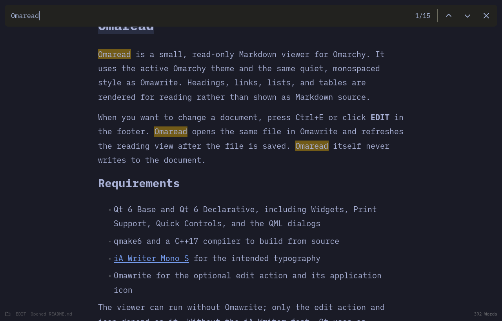

# Omaread

Omaread is a small, read-only Markdown viewer for Omarchy. It uses the active
Omarchy theme and the same quiet, monospaced style as Omawrite. Headings, links,
lists, and tables are rendered for reading rather than shown as Markdown source.



When you want to change a document, press `Ctrl+E` or click **EDIT** in the footer.
Omaread opens the same file in Omawrite and refreshes the reading view after the
file is saved. Omaread itself never writes to the document.

## Requirements

- Qt 6 Base and Qt 6 Declarative, including Widgets, Print Support, Quick Controls, and the QML dialogs
- `qmake6` and a C++17 compiler to build from source
- [iA Writer Mono S](https://github.com/iaolo/iA-Fonts) for the intended typography
- Omawrite for the optional edit action

The viewer can run without Omawrite; only the edit action depends on it.
Without the iA Writer font, Qt uses an installed fallback font.

## Build and run

```sh
qmake6 omaread.pro
make
./omaread document.md
```

Opening Omaread without a file shows a file picker shortcut (`Ctrl+O`). You can
also drop a local Markdown file onto its window.

## Install for your user

Make sure `~/.local/bin` is in your desktop session's `PATH`, then run:

```sh
install -Dm755 omaread "$HOME/.local/bin/omaread"
install -Dm644 omaread.desktop "$HOME/.local/share/applications/omaread.desktop"
install -Dm644 icons/omaread.svg "$HOME/.local/share/icons/hicolor/scalable/apps/omaread.svg"
```

To make it the default Markdown viewer:

```sh
xdg-mime default omaread.desktop text/markdown text/x-markdown
```

## Shortcuts

| Shortcut | Action |
| --- | --- |
| `Ctrl+O` | Open a file |
| `Ctrl+N` | Open a new Omaread window |
| `Ctrl+E` | Edit the open file in Omawrite |
| `Ctrl+P` | Print the rendered document |
| `Ctrl+F` | Find text in the open file |
| `Enter` / `Shift+Enter` | Next / previous match while searching |
| `Ctrl+G` / `Ctrl+Shift+G` | Next / previous match while searching |
| `Escape` | Close search |
| `Ctrl+R` | Reload the file |
| `Ctrl+=` / `Ctrl+-` | Zoom in / out |
| `Ctrl+0` | Reset zoom |
| `F11` / `Super+F` | Toggle fullscreen |
| `Ctrl+?` / `F1` | Show keyboard shortcuts |

Search highlights every match and shows the current match number. Print opens
the system dialog and prints rendered Markdown. Omaread watches the open file
for changes once per second. It only opens local files and reads them as UTF-8.

Omaread is an independent project inspired by the MIT-licensed
[Omawrite](https://github.com/omacom/omawrite). The small folder button follows
Omawrite's design; the Omaread app icon is original. Omaread does not bundle
Omawrite or the iA Writer font.

## License

MIT. See [LICENSE](LICENSE).
